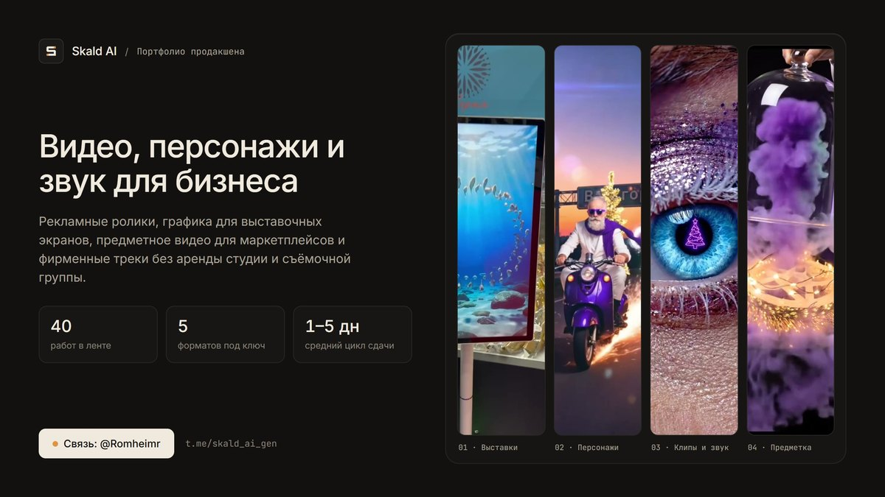

<div align="center">

# ✦ Skald AI

**Студийный веб-лукбук: рекламные ролики, сквозные бренд-герои и фирменные песни для бизнеса.**

[](https://github.com/SkrudjReal/skald-ai/issues)
[](https://github.com/SkrudjReal/skald-ai/pulls)
[](https://github.com/SkrudjReal/skald-ai/stargazers)
[](https://github.com/SkrudjReal/skald-ai/forks)



[Витрина](#-что-внутри) · [Локальный запуск](#-локальный-запуск) · [Структура](#-структура) · [Сообщить об ошибке](https://github.com/SkrudjReal/skald-ai/issues/new)

</div>

---

Одностраничный веб-лукбук **Skald AI** для заказчиков вне Telegram: живые видеопетли, шоурил со звуком, сетка из 15 коммерческих работ, разбор выставочного кейса «Северия», плеер авторских песен и форма быстрой заявки в `@Romheimr`.

## ✦ Что внутри

| Раздел | Содержимое | Формат |
| :--- | :--- | :--- |
| ✦ Первый экран | Живые беззвучные видеопетли и модальный плеер шоурила (36 сек) | `MP4` · `WebP` · `<dialog>` |
| ◇ Стена работ | 15 кликабельных роликов: маркетплейсы, Reels, бренд-герои, B2B | Адаптивная модульная сетка |
| ✧ Кейс «Северия» | Выставочный стенд и роботы-промоутеры на Seafood Expo Russia | Мозаика кадров + видео со стенда |
| ✦ Песни бренда | 4 авторских трека для кампании Crystal Trees с прогресс-баром | `MP3` · одиночный аудиоплеер |
| ◇ Быстрый бриф | Выбор формата и переход в диалог [@Romheimr](https://t.me/Romheimr) с готовым текстом | Копирование в буфер + `t.me` |

> [!NOTE]
> Полный архив свежих видео-кейсов (включая разборы «До / После 4K» и витрины для WB / Ozon) публикуется в Telegram-канале [@skald_ai_gen](https://t.me/skald_ai_gen/101).

## ◇ Локальный запуск

Сайт собран на чистом HTML, CSS и JavaScript без сборщиков и внешних зависимостей:

```bash
python -m http.server 8765
```

После запуска открой `http://127.0.0.1:8765` в браузере.

## ✧ Структура

| Путь | Назначение |
| :--- | :--- |
| `index.html` | Разметка страницы, метаданные Open Graph и модальный видеоплеер |
| `styles.css` | Тёмная студийная палитра Warm Graphite + Amber, модульная сетка и адаптив |
| `app.js` | Плавное появление блоков, видеоплеер, аудиоплитки, аккордеон этапов и бриф |
| `media/` | Оптимизированные для веба ролики (`clips/`, `loops/`), постеры (`WebP`) и аудио (`MP3`) |
| `.nojekyll` | Прямая раздача статики на GitHub Pages без сборки Jekyll |
